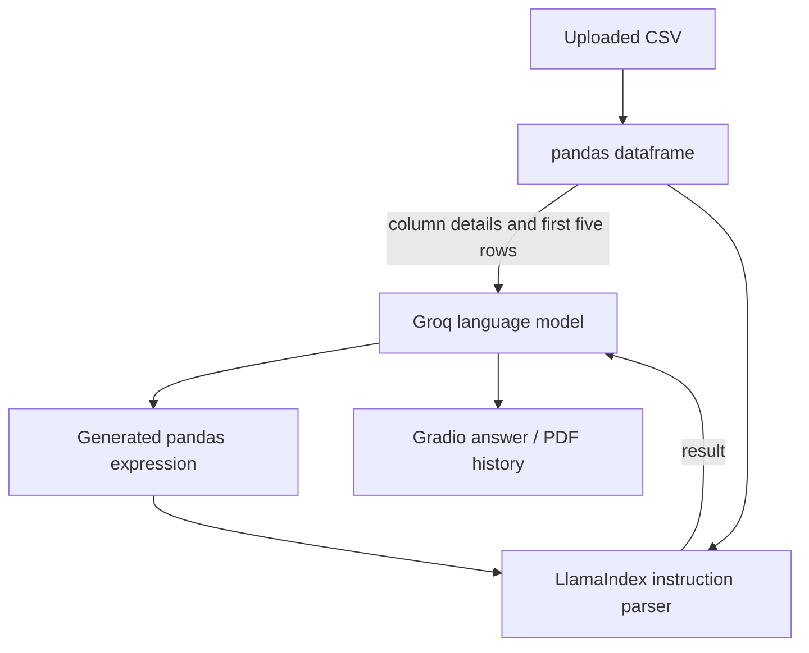

# CSV Questions and PDF Reports

**Ask natural-language questions about a CSV and export selected answers to a PDF.**

An educational prototype using Gradio, pandas, LlamaIndex, and a Groq-hosted language model. The application generates pandas expressions, evaluates them against an uploaded dataframe, and summarizes the result. The Zoop scenario is presented as a learning scenario, not evidence of a verified commercial engagement.

## Product workflow

1. Upload a CSV and inspect its preview.
2. Ask a question such as “How many records are in this file?”
3. Inspect the answer and generated expression.
4. Add selected answers to a report and download the PDF.

## Data flow and trust boundary



**This is not private local inference.** Samples and query results can be sent to the external provider. The instruction parser evaluates model-generated code; no process sandbox is implemented. Run locally with trusted users and synthetic data. Do not expose the interface as a public service in its current form.

## Run locally

```bash
git clone https://github.com/joaovitormessias/projeto-vendas.git
cd projeto-vendas
python -m venv .venv
source .venv/bin/activate
pip install -r requirements.txt
export GROQ_API_KEY='your-own-key'
export GROQ_MODEL='a-compatible-model-available-in-your-account'
python app.py
```

Use the local URL printed by Gradio. `secret_key` remains accepted as a legacy key variable. The historical default model identifier is retained for compatibility, but its present availability has not been verified; set `GROQ_MODEL` explicitly for your provider account. No paid provider call was made during this review.

## Review points

- [app.py](app.py): dataframe loading, query pipeline, answer history, and PDF callbacks.
- [projetoVendas.ipynb](projetoVendas.ipynb): exploratory notebook; it is not the required application entry point.
- [vendas.csv](vendas.csv): bundled sample input; inspect it before sending any portion to a provider.

The empty-report callback now returns `None`, matching Gradio File output semantics, instead of an incompatible tuple. Missing credentials fail with a clear configuration message.

## Verification

```bash
python -m py_compile app.py
python -m unittest discover -s tests
```

Local callback regression tests do not invoke a model or upload data. A complete demonstration still requires a compatible provider model and manual comparison of answers against pandas calculations.

## Limitations and next steps

No sandbox, authentication, deterministic answer evaluation, query allowlist, or cost controls are implemented. Generated code and summaries can be wrong. PDF font support and long/unicode responses need testing. Replace unrestricted generated-code evaluation with a constrained query interface before expanding access.

[MIT license](LICENSE) · [Maintainer](https://github.com/joaovitormessias)
